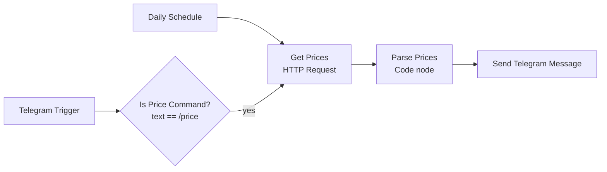

# Telegram USD & Gold Price Bot (n8n)

An automation built with [n8n](https://n8n.io) that delivers the latest **US dollar** and **18k gold** prices (in Iranian Toman) through a Telegram bot. It sends a scheduled message every day and also replies instantly when you send the `/price` command.

## Features

- **Daily push message** at a fixed time, delivered to a private Telegram chat.
- **On-demand replies**: send `/price` to the bot and get the current prices back.
- **Clear timestamps**: each price shows the time the data provider last updated it, plus the Jalali (Persian calendar) date and Tehran time of the fetch.
- **Clean formatting**: Persian digits with thousands separators, no n8n attribution footer.
- **Single shared data path**: both triggers reuse the same fetch, parse and send nodes, so there is no duplicated logic.

## How it works



1. **Daily Schedule** (cron `0 9 * * *`) or **Telegram Trigger** (filtered to `/price` by an IF node) starts the flow.
2. **Get Prices** calls the [navasan.tech](http://navasan.tech) API with an API key stored as an n8n *Query Auth* credential.
3. **Parse Prices** (JavaScript Code node) extracts the USD and 18k gold values, formats them, and picks the target chat: the sender's chat for `/price`, or your configured chat ID for scheduled runs.
4. **Send Telegram Message** posts the formatted message.

## Tech stack

- n8n (Schedule Trigger, Telegram Trigger, IF, HTTP Request, Code, Telegram nodes)
- Telegram Bot API
- navasan.tech price API
- JavaScript (Code node) with `Intl` for Jalali dates and Persian number formatting

## Sample output

The bot's messages are in Persian, since the prices are meant for Persian-speaking users:

```
💵 دلار: ۲۳۵٬۲۰۰ تومان
🕐 آخرین تغییر: ۱۴۰۵/۰۷/۰۵ - ۲۱:۰۱

🥇 طلای ۱۸ عیار: ۲۴٬۰۲۰٬۰۴۰ تومان
🕐 آخرین تغییر: ۱۴۰۵/۰۷/۰۶ - ۰۷:۳۰

📅 تاریخ دریافت: ۱۴۰۵/۰۷/۰۶
⏰ ساعت دریافت: ۰۷:۳۲
```

## Setup

### Prerequisites

- An n8n instance (n8n Cloud or self-hosted)
- A Telegram account
- An API key from [navasan.tech](http://navasan.tech)

### Steps

1. **Create the bot.** In Telegram, message `@BotFather`, run `/newbot`, choose a name and a username ending in `bot`, and copy the token it gives you.
2. **Find your chat ID.** Message `@userinfobot` and copy the numeric `Id`. Then open a chat with your own bot and press *Start* once, because bots cannot message users who have not contacted them first.
3. **Create credentials in n8n:**
   - **Telegram API**: paste the bot token into *Access Token* (leave the base URL as `api.telegram.org`).
   - **Query Auth**: set *Name* to `api_key` and *Value* to your navasan.tech key.
4. **Import the workflow.** In n8n choose *Import from File* and select `workflows/telegram-usd-gold-bot.json`.
5. **Attach credentials.** Select the Telegram credential on the *Telegram Trigger* and *Send Telegram Message* nodes, and the Query Auth credential on *Get Prices*.
6. **Set your chat ID.** In the *Parse Prices* node, replace `YOUR_TELEGRAM_CHAT_ID` with your numeric chat ID. This is used for scheduled runs.
7. **Check the schedule.** The cron expression uses the timezone of your n8n instance or workflow settings. Adjust the hour (or the workflow timezone) to when you want the message.
8. **Activate** the workflow, then send `/price` to your bot to verify it.

## Customization

- **Change the time:** edit the cron expression in *Daily Schedule*.
- **Add more assets** (for example EUR or coins): read the extra fields from the API response in *Parse Prices* and append them to the message.
- **Switch data provider:** change the URL and authentication in *Get Prices* and adjust the field names in *Parse Prices*.
- **Send to a group or channel:** use that chat's ID in *Parse Prices* and add the bot to it.

## Security notes

- The bot token and API key live only in n8n's credential store and are **not** part of the exported workflow. Never commit them to the repository.
- If a token is ever exposed, revoke it with `/revoke` in `@BotFather` and update the n8n credential.
- The `/price` command replies to whoever sends it. If you want a private bot, add a check on the sender's chat ID before *Get Prices*.

## Project structure

```
.
├── README.md
├── .gitignore
└── workflows/
    └── telegram-usd-gold-bot.json
```
